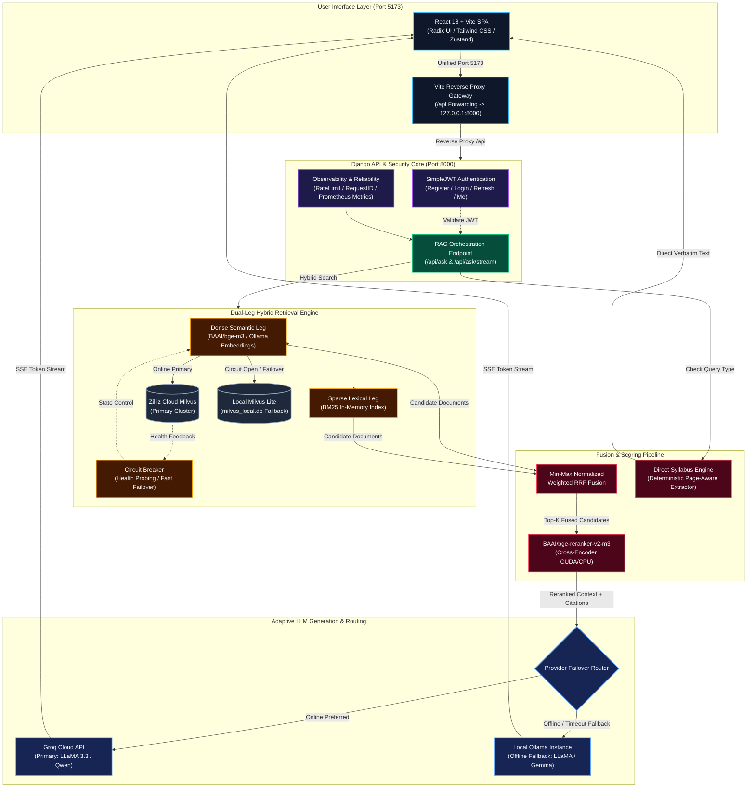

# AcademeRAG-Final

<p align="center">
  
  
  
  
  
  
  
  
  
</p>

AcademeRAG is an enterprise-grade, full-stack Retrieval-Augmented Generation (RAG) platform tailored for academic research, university curricula, and scholarly question answering. It unites a Django REST API backend, an interactive React + TypeScript client with streaming UX, and a resilient dual-mode vector retrieval engine supporting both Cloud Milvus (Zilliz) and local Milvus Lite fallbacks with hybrid BM25 and neural cross-encoder reranking.

---

## System Architecture

The following diagram illustrates the complete interactive runtime topology of AcademeRAG, tracing requests from the client down to the neural reranker and LLM providers:



---

## Runtime Query & Failover Workflow

The pipeline executes a deterministic, multi-layered decision tree for each query:

```mermaid
flowchart LR
    %% Styling Classes
    classDef stepStart fill:#0f172a,stroke:#38bdf8,stroke-width:2px,color:#f8fafc;
    classDef stepCheck fill:#1e1b4b,stroke:#a855f7,stroke-width:2px,color:#f8fafc;
    classDef stepRetrieve fill:#451a03,stroke:#f59e0b,stroke-width:2px,color:#f8fafc;
    classDef stepProcess fill:#4c0519,stroke:#f43f5e,stroke-width:2px,color:#f8fafc;
    classDef stepOutput fill:#064e3b,stroke:#10b981,stroke-width:2px,color:#f8fafc;

    Q["User Query<br/>(http://localhost:5173)"]:::stepStart --> GW["Gateway Proxy &<br/>JWT Security"]:::stepCheck
    GW --> DETECT{"Syllabus / Unit<br/>Direct Query?"}:::stepCheck

    DETECT -->|Yes| SYL["Deterministic PDF<br/>Page Text Extraction"]:::stepProcess
    SYL --> RESP["Cleaned Output + Citations"]:::stepOutput

    DETECT -->|No| PARALLEL["Parallel Hybrid Retrieval"]:::stepRetrieve
    
    subgraph DUAL["Parallel Retrieval Legs"]
        DENSE_LEG["Dense Search<br/>(Milvus Cloud / Local)"]:::stepRetrieve
        SPARSE_LEG["Sparse Search<br/>(BM25 Index)"]:::stepRetrieve
    end
    PARALLEL --> DUAL

    DUAL --> FUSE["Min-Max Weighted Fusion<br/>(0.3 Dense + 0.7 BM25)"]:::stepProcess
    FUSE --> RERANK_NODE["BGE Cross-Encoder Reranker<br/>(Threshold Cutoff: 0.2)"]:::stepProcess
    RERANK_NODE --> ROUTE_LLM{"Online Groq<br/>Available?"}:::stepCheck

    ROUTE_LLM -->|Yes| GROQ_EXEC["Groq Ultra-Fast Inference<br/>(Streaming SSE)"]:::stepOutput
    ROUTE_LLM -->|No / Offline| OLLAMA_EXEC["Local Ollama Inference<br/>(Offline Fallback)"]:::stepOutput

    GROQ_EXEC & OLLAMA_EXEC --> STREAM["Chunked Markdown Stream<br/>to Client Interface"]:::stepOutput
```



---

## Core Capabilities

- **Unified Single-Port Access (`http://localhost:5173`)**: The entire full-stack application (React client, static assets, and Django `/api/` endpoints) is accessed through port 5173 via Vite's high-speed reverse proxy.
- **Enterprise JWT Authentication**: Secure access and refresh token lifecycle, user registration, account state validation, and strict rate-limiting per IP/user.
- **Hybrid Dense + Sparse Search**: Combines semantic embeddings with BM25 keyword matching using Min-Max Normalized Weighted Fusion for optimal recall.
- **Neural Cross-Encoder Reranking**: Re-ranks top candidate chunks using `BAAI/bge-reranker-v2-m3` on local CUDA or CPU, filtering low-confidence results with a cutoff threshold (`0.2`).
- **Cloud-to-Local Resilience**: Automatic circuit breakers detect Zilliz Cloud latency or downtime, instantly falling back to local Milvus Lite and cached disk indexes.
- **Dual LLM Routing**: Ultra-low latency responses via Groq Cloud (`llama-3.3-70b-versatile` / `qwen-2.5-32b`) when online; seamless automatic fallback to local Ollama (`llama3.2` / `gemma2`) when offline.
- **Deterministic Syllabus Extraction**: Academic syllabus and unit-wise queries bypass LLM hallucination and return verbatim, header-cleaned text extracted directly from course catalog PDFs.
- **Interactive Markdown Streaming**: Real-time server-sent events (SSE) with mid-stream interruption, sequential ordered-list numbering, code highlighting, and persistent thread sessions.

---

## Repository Structure

```text
AcademeRAG-Final/
├── main.py                     # Unified local launcher (preflight, migrations, backend, frontend)
├── manage.py                   # Django management CLI
├── rag_project/                # Django project settings, URLs, WSGI/ASGI configuration
├── api/                        # REST & Streaming endpoints, auth, metrics, rate limits, tests
├── database/                   # Retrieval engine: Milvus client, BM25, embeddings, chunking, reranker
├── rag/                        # LLM orchestration, provider failover, scoring, PDF sandbox
├── Milvus.py                   # Backward-compatible re-export facade
├── Frontend/                   # React 18 + TypeScript + Vite web client
│   ├── src/                    # UI components, pages (ChatPage, AuthPage), Zustand store, API client
│   ├── package.json            # Scripts configured with Vite native config loader
│   └── vite.config.mjs         # Pure ESM Vite configuration with reverse proxy to Django
├── documents/                  # Source academic PDF corpus for indexing
├── eval/                       # RAG quality gate evaluation scripts, golden sets, thresholds
└── .github/workflows/          # CI/CD pipelines (unit tests, coverage, bundle budget, security)
```

---

## Quickstart

### Prerequisites

- **Python**: 3.11+ (recommended: 3.11 - 3.13)
- **Node.js**: 18+ (tested on Node 20 / 22 / 24)
- **Optional**: [Ollama](https://ollama.com/) running locally for offline LLM generation

### 1. Setup Environment Configuration

Clone the repository and create your environment configuration:

```bash
git clone https://github.com/Xeneium/AcademeRAG-Final.git
cd AcademeRAG-Final
cp .env.example .env
```

Review `.env` and fill in:
- `DJANGO_SECRET_KEY`: Set a secure random string.
- `GROQ_API_KEY`: (Optional) Your Groq API key for cloud LLM acceleration.
- `ACADEMERAG_MILVUS_URI`: Zilliz Cloud URI or local path (`milvus_local.db`).

### 2. Install Dependencies

**Backend**:
```bash
python -m venv .venv

# On Linux/macOS:
source .venv/bin/activate
# On Windows (PowerShell):
.venv\Scripts\Activate.ps1

pip install -r requirements.txt
```

**Frontend**:
```bash
cd Frontend
npm ci
cd ..
```

### 3. Run the Application

Start both the backend and frontend together with the unified launcher:

```bash
python main.py
```

The launcher will automatically:
1. Run preflight health and connectivity checks (Environment, Milvus, BM25, Embeddings).
2. Execute Django database migrations.
3. Start the Django API worker on `http://127.0.0.1:8000`.
4. Start the Vite development server on `http://localhost:5173`.
5. Establish the Unified API Gateway reverse proxy at `http://localhost:5173/api/`.

Open your browser at: **`http://localhost:5173`**

---

## Document Ingestion

To ingest or update course documents in the vector database:

1. Place your academic PDFs in the `documents/` directory.
2. Run the safe indexing pipeline:

```bash
python create_milvus_collection.py --recreate-safe
```

Or run the automated setup utility:

```bash
python setup_milvus.py
```

---

## API Endpoints

### Authentication
| Method | Endpoint | Description |
|---|---|---|
| `POST` | `/api/auth/register/` | Register a new user account |
| `POST` | `/api/auth/login/` | Authenticate and obtain JWT access & refresh tokens |
| `POST` | `/api/auth/refresh/` | Rotate and issue a new JWT access token |
| `GET` | `/api/auth/me/` | Fetch authenticated user profile |

### RAG & Querying
| Method | Endpoint | Description |
|---|---|---|
| `POST` | `/api/ask/` | Submit a question and receive a JSON grounded response |
| `POST` | `/api/ask/stream/` | Submit a question and receive a Server-Sent Events (SSE) stream |

### Operations & Diagnostics
| Method | Endpoint | Description |
|---|---|---|
| `GET` | `/api/health/live/` | Liveness probe (Kubernetes / load-balancer ready) |
| `GET` | `/api/health/ready/` | Dependency readiness probe (Milvus, Ollama, Database) |
| `GET` | `/api/metrics/` | Prometheus format latency and throughput metrics |
| `GET` | `/api/admin/retrieval/diagnostics/` | Staff-only retrieval diagnostics & circuit status |

---

## Testing & Verification

Run the full automated test suite across backend and frontend:

**Backend Tests**:
```bash
python manage.py check
python manage.py test
```

**Frontend Tests & Quality Checks**:
```bash
cd Frontend
npm run lint
npm run test
npm run test:coverage
npm run build
npm run perf:budget
```

**RAG Evaluation Gate**:
```bash
python eval/rag_eval.py
```

---

## Security & Reliability Architecture

- **Path & Sandbox Protection**: Pre-ingestion validation ensures only verified PDFs with valid `%PDF-` magic bytes are processed; malformed files are rejected before chunking.
- **Failover Circuit Breaker**: Cloud Milvus failures trip a state machine (Closed -> Open -> Half-Open) with a 300s cooldown to prevent request hangs.
- **Rate Limiting**: Defends authentication and question endpoints against brute-force attacks (`django-ratelimit`).
- **Safe Cache Directories**: Local models, inductor caches, and PyTorch dynamic caches are contained within the workspace `.cache/` directory to prevent filesystem permissions issues.
- **Supply Chain Security**: Continuous GitHub Actions pipelines run `gitleaks`, `pip-audit`, `bandit`, and generate Software Bill of Materials (SBOM) for compliance.

---

## License

This project is licensed under the Apache 2.0 License.
