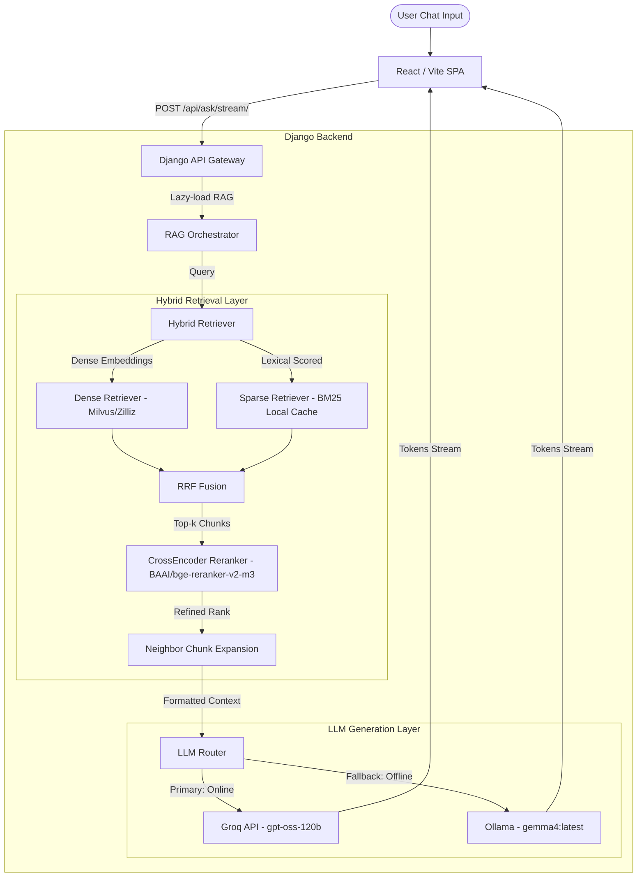

# Cognivia Core Architecture Documentation

This document describes the core architecture of the **Cognivia** platform, a high-performance, hybrid Retrieval-Augmented Generation (RAG) platform designed for academic question-answering.

---

## Architecture Overview

The system is structured as a full-stack, local-first RAG application with online acceleration capabilities. It has four main layers:

1. **Client / Frontend**: A single-page React application that communicates with the backend via REST endpoints and server-sent events (SSE) for streaming text generation.
2. **API / Backend (Django)**: A secure API endpoint handling authentication, rate limiting, logging, and routing.
3. **Retrieval Layer (Hybrid)**: A hybrid search system combining dense vector search (Milvus/Zilliz) and sparse keyword search (BM25 over local cache), fused via Reciprocal Rank Fusion (RRF) and refined with a CrossEncoder reranker.
4. **LLM Orchestration Layer**: An intelligent routing middleware that handles failover between primary online APIs (Groq) and local offline instances (Ollama).

---

## 1. Client / Frontend Layer

The frontend is built using **React, TypeScript, and Vite**. It handles:
- **Authentication**: JWT access and refresh token management stored securely in browser state and resolved on each request via API interceptors.
- **Server-Sent Events (SSE)**: Renders tokens chunk-by-chunk for low latency, utilizing structured JSON event chunks (`{"type": "token", "content": "..."}`) sent from the Django backend.
- **Stream Interruption**: Supports terminating in-flight streams by issuing cancellation requests to the backend.
- **Markdown & Math Rendering**: Renders formulas (using inline and block formatting) and code snippets directly in the chat bubbles.

---

## 2. API / Backend Layer (Django)

The backend is a **Django** application serving as the API Gateway:
- **Authentication Gateway**: All conversational endpoints are protected by SimpleJWT authentication (`@jwt_required` decorator).
- **Security & Rate Limiting**: Employs pre-flight prompt injection scanners to detect jailbreaks and `django-ratelimit` to protect against request spikes.
- **Lazy Loading**: RAG modules, model initializations, and database connections are loaded lazily to ensure Django commands (like migrations and startup probes) run instantaneously without waiting on model loads.
- **Observability**: Exposes metrics endpoints in Prometheus format via `django-prometheus`.

---

## 3. Hybrid Retrieval Layer

To provide robust and contextually complete academic answers, the retrieval pipeline combines lexical accuracy and semantic understanding:

### Dense Retrieval (Milvus & Zilliz Cloud)
- **Embedding Generation**: User queries are embedded locally using the `bge-m3:latest` embedding model running in Ollama.
- **Vector Database**: Connects to **Zilliz Cloud (Milvus serverless)** as the primary vector store.
- **Resilience / Circuit Breaker**: If the Zilliz Cloud endpoint becomes unreachable or fails consecutively, the circuit breaker opens, temporarily diverting all dense queries to a fallback local SQLite-based vector store (`milvus_local.db`).

### Sparse Retrieval (BM25 Local Cache)
- **Local Fallback & Sparse Leg**: The project maintains a cached local BM25-style inverted index stored in `bm25_index.pkl`.
- **Pre-computed Corpus**: At startup, if the index is missing or out-of-date compared to files in `documents/`, it builds the index asynchronously.

### Min-Max Normalized Weighted Fusion
The results from the dense and sparse legs are merged using Min-Max Normalized Weighted Fusion:
\[ Score(d) = w \cdot Norm(Dense\_Score(d)) + (1 - w) \cdot Norm(Sparse\_Score(d)) \]
where the dense weight $w$ is defined by `COGNIVIA_RRF_DENSE_WEIGHT` (empirically tuned to `0.3` via grid-search on the golden set).
- **Min-Max Normalization**: Dense and sparse scores are normalized to a `[0, 1]` range to make their scores comparable before weighted summation.
- **Single-Leg Bypass**: If either retrieval leg is empty, the RRF block bypasses fusion calculations and directly yields the non-empty candidate list to prevent empty-set errors and unnecessary latency.

### Reranker (CrossEncoder)
- **Reranker Model**: The candidate chunks are reranked using the **`BAAI/bge-reranker-v2-m3`** model loaded via `sentence_transformers`.
- **Sequence Classification**: The query and each document chunk are passed together as pairs to determine an exact similarity classification score, refining the ranking.
- **Configurable Cutoff Filtering**: To prevent noise, hallucinations, and irrelevant answers, any chunk with a reranking score below `COGNIVIA_RERANK_CUTOFF` (empirically tuned to `0.2` via grid-search) is discarded.
- **GPU Acceleration**: The pipeline utilizes local GPU acceleration (via CUDA) when available, reducing reranking latency from ~25-50 seconds (CPU) to ~1.4 seconds (GPU, e.g. NVIDIA RTX 3070).
- **Offline Safety**: Disables Hugging Face Hub checking after the first load (`HF_HUB_OFFLINE = 1`) to ensure 100% offline retrieval speed.

### Neighbor Chunk Expansion
Once the top-$k$ chunks are selected, the retriever performs neighbor expansion. It fetches the immediately preceding and succeeding chunks (by `chunk_index` on the same document) to reconstruct surrounding context, mitigating cutoff sentences in retrieved passages.

---

## 4. LLM Generation Layer

The orchestrator chooses the LLM provider dynamically depending on environment configuration and internet reachability:

- **Primary (Groq API)**: If `GROQ_API_KEY` is configured and internet is reachable, the query is sent to Groq. The configured model is **`openai/gpt-oss-120b`**.
- **Fallback (Ollama Local)**: If Groq fails due to authentication issues (e.g., expired API key), rate limits, or internet loss, the system immediately downgrades the request to a local Ollama instance running the **`gemma4:latest`** model.
- **Limits Safeguard**: Both providers are configured with a strict generation limit (`max_tokens=4096` / `num_predict=4096`) and Ollama is initialized with a larger context window (`num_ctx=16384`) to prevent truncation and cutoff errors.
