# Codebase Architecture Report & Dependency Graph
Generated by: Architecture & System Audit Agent (Agent 1)
Timestamp: 2026-06-05 08:46:18

## Component Mapping
- **Database & Ingestion Layer**: Loading, parsing, chunking, and embedding PDFs. Vector DB (Zilliz / Milvus Lite) and BM25 setups.
- **RAG & Orchestration Layer**: Reranking, retrieval logic, prompting, provider failovers (Groq / Ollama).
- **Web API (Django)**: REST endpoints, tracking models, metrics, and health endpoints.
- **Frontend Layer**: TypeScript/React dashboard with client-side sanitization.

## System Dependency Graph

```mermaid
graph TD
    database_bm25_py["database/bm25.py"]
    database_bm25_py --> database_config_py
    database_bm25_py --> database_metadata_py
    database_bm25_py --> database_ingestion_py
    database_bm25_py --> database_chunking_py
    database_bm25_py --> database_ingestion_py
    database_bm25_py --> database_chunking_py
    database_chunking_py["database/chunking.py"]
    database_chunking_py --> database_config_py
    database_chunking_py --> rag_pdf_sandbox_py
    database_chunking_py --> database_ingestion_py
    database_chunking_py --> database_ingestion_py
    database_chunking_py --> database_chunking_py
    database_config_py["database/config.py"]
    database_embedding_py["database/embedding.py"]
    database_embedding_py --> database_config_py
    database_ingestion_py["database/ingestion.py"]
    database_ingestion_py --> database_config_py
    database_ingestion_py --> database_embedding_py
    database_ingestion_py --> database_milvus_client_py
    database_ingestion_py --> database_metadata_py
    database_ingestion_py --> api_models_py
    database_ingestion_py --> database_config_py
    database_ingestion_py --> database___init___py
    database_ingestion_py --> database_chunking_py
    database_ingestion_py --> database_milvus_client_py
    database_ingestion_py --> database_metadata_py
    database_ingestion_py --> database___init___py
    database_metadata_py["database/metadata.py"]
    database_metadata_py --> database_config_py
    database_metadata_py --> database_ingestion_py
    database_metadata_py --> database_bm25_py
    database_milvus_client_py["database/milvus_client.py"]
    database_milvus_client_py --> database_config_py
    database_milvus_client_py --> database_metadata_py
    database_milvus_client_py --> database_config_py
    database_milvus_client_py --> api_models_py
    database_reranker_py["database/reranker.py"]
    database_retrieval_py["database/retrieval.py"]
    database_retrieval_py --> database_config_py
    database_retrieval_py --> database_bm25_py
    database_retrieval_py --> database_embedding_py
    database_retrieval_py --> database_metadata_py
    database_retrieval_py --> database_milvus_client_py
    database_retrieval_py --> database_reranker_py
    database_retrieval_py --> database_ingestion_py
    rag_llm_orchestration_py["rag/llm_orchestration.py"]
    rag_llm_orchestration_py --> database___init___py
    rag_llm_orchestration_py --> rag_scoring_py
    rag_llm_orchestration_py --> rag_scoring_py
    rag_llm_orchestration_py --> rag_scoring_py
    rag_llm_orchestration_py --> rag_scoring_py
    rag_llm_orchestration_py --> rag_scoring_py
    rag_pdf_sandbox_py["rag/pdf_sandbox.py"]
    rag_scoring_py["rag/scoring.py"]
    rag_scoring_py --> database___init___py
    api_admin_py["api/admin.py"]
    api_apps_py["api/apps.py"]
    api_apps_py --> database_bm25_py
    api_apps_py --> database___init___py
    api_apps_py --> api_views_py
    api_auth_utils_py["api/auth_utils.py"]
    api_auth_views_py["api/auth_views.py"]
    api_error_views_py["api/error_views.py"]
    api_logging_filters_py["api/logging_filters.py"]
    api_logging_formatters_py["api/logging_formatters.py"]
    api_metrics_py["api/metrics.py"]
    api_middleware_py["api/middleware.py"]
    api_models_py["api/models.py"]
    api_rate_limit_py["api/rate_limit.py"]
    api_request_context_py["api/request_context.py"]
    api_responses_py["api/responses.py"]
    api_settings_py["api/settings.py"]
    api_tests_py["api/tests.py"]
    api_tests_py --> api___init___py
    api_tests_py --> api___init___py
    api_tests_py --> rag_llm_orchestration_py
    api_tests_py --> database_milvus_client_py
    api_tests_py --> database_milvus_client_py
    api_tests_py --> database_milvus_client_py
    api_tests_py --> database_milvus_client_py
    api_tests_py --> database_milvus_client_py
    api_tests_py --> database_milvus_client_py
    api_tests_py --> database_milvus_client_py
    api_tests_py --> database_milvus_client_py
    api_tests_py --> database_milvus_client_py
    api_tests_py --> database_milvus_client_py
    api_tests_py --> database_milvus_client_py
    api_tests_py --> database_retrieval_py
    api_tests_py --> database_milvus_client_py
    api_tests_py --> database_milvus_client_py
    api_test_index_sync_py["api/test_index_sync.py"]
    api_test_index_sync_py --> database___init___py
    api_test_rag_controls_py["api/test_rag_controls.py"]
    api_test_rag_controls_py --> database___init___py
    api_test_rag_controls_py --> rag_llm_orchestration_py
    api_test_rag_controls_py --> rag_scoring_py
    api_test_security_py["api/test_security.py"]
    api_test_security_py --> database___init___py
    api_test_security_offline_py["api/test_security_offline.py"]
    api_urls_py["api/urls.py"]
    api_views_py["api/views.py"]
    api_migrations_0001_initial_py["api/migrations/0001_initial.py"]
    rag_project_asgi_py["rag_project/asgi.py"]
    rag_project_settings_py["rag_project/settings.py"]
    rag_project_urls_py["rag_project/urls.py"]
    rag_project_wsgi_py["rag_project/wsgi.py"]
```

