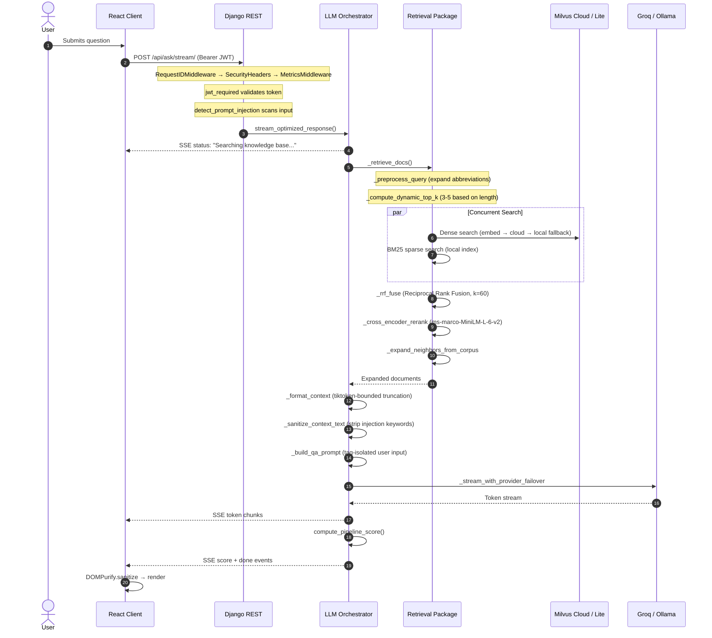
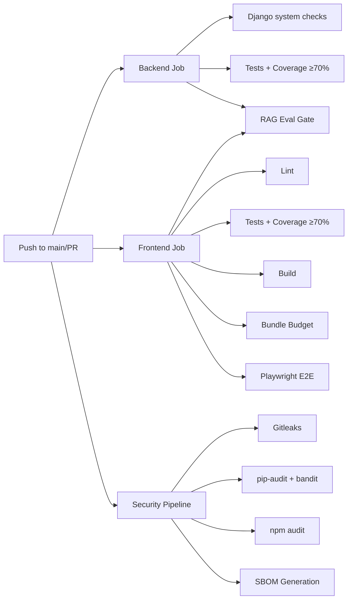

# AcademeRAG Production Readiness Audit

> Evidence-based engineering review. All findings reference actual source code with file:line citations.

---

## 1. Architecture Review

### System Overview

AcademeRAG is a **modular monolith** consisting of:

| Layer | Technology | Entry Point |
|---|---|---|
| Frontend | React 18 + Vite + TypeScript + TailwindCSS + Zustand | [main.tsx](file:///c:/Sabareesh/AcademeRAG%20-%20Research/AcademeRAG-Final/Frontend/src/main.tsx) |
| API | Django 4.2+ REST (synchronous) | [views.py](file:///c:/Sabareesh/AcademeRAG%20-%20Research/AcademeRAG-Final/api/views.py) |
| RAG Pipeline | LangChain + Groq/Ollama failover | [llm_orchestration.py](file:///c:/Sabareesh/AcademeRAG%20-%20Research/AcademeRAG-Final/rag/llm_orchestration.py) |
| Retrieval | Hybrid dense (Milvus) + sparse (BM25) + RRF + CrossEncoder reranking | [retrieval.py](file:///c:/Sabareesh/AcademeRAG%20-%20Research/AcademeRAG-Final/database/retrieval.py) |
| Vector Store | Milvus Cloud (Zilliz) primary / Milvus Lite local fallback | [milvus_client.py](file:///c:/Sabareesh/AcademeRAG%20-%20Research/AcademeRAG-Final/database/milvus_client.py) |
| Auth | JWT (SimpleJWT) with access/refresh rotation and blacklisting | [auth_views.py](file:///c:/Sabareesh/AcademeRAG%20-%20Research/AcademeRAG-Final/api/auth_views.py) |
| Persistence | SQLite (dev) / PostgreSQL (prod) for Django ORM; Milvus for vectors | [settings.py:103-123](file:///c:/Sabareesh/AcademeRAG%20-%20Research/AcademeRAG-Final/rag_project/settings.py#L103-L123) |

### Request Lifecycle (Traced from Source)



### Architectural Strengths

1. **Clean module boundaries** — `database/` package encapsulates all retrieval logic with a well-defined public API surface in [\_\_init\_\_.py](file:///c:/Sabareesh/AcademeRAG%20-%20Research/AcademeRAG-Final/database/__init__.py).
2. **Dual-mode vector store** — Cloud primary with automatic local fallback via circuit breaker pattern in [milvus_client.py](file:///c:/Sabareesh/AcademeRAG%20-%20Research/AcademeRAG-Final/database/milvus_client.py).
3. **LLM failover** — Groq (online) → Ollama (offline) with thread-safe circuit breaker, internet check caching (30s TTL), and failure classification in [llm_orchestration.py:114-149](file:///c:/Sabareesh/AcademeRAG%20-%20Research/AcademeRAG-Final/rag/llm_orchestration.py#L114-L149).
4. **PDF sandbox isolation** — Document parsing runs in a separate process via [pdf_sandbox.py](file:///c:/Sabareesh/AcademeRAG%20-%20Research/AcademeRAG-Final/rag/pdf_sandbox.py).
5. **Environment-driven config** — All tunables are environment variables with validation in [settings.py:17-43](file:///c:/Sabareesh/AcademeRAG%20-%20Research/AcademeRAG-Final/rag_project/settings.py#L17-L43) and [config.py:31-63](file:///c:/Sabareesh/AcademeRAG%20-%20Research/AcademeRAG-Final/database/config.py#L31-L63).

### Architectural Risks

| ID | Finding | Severity | Evidence |
|---|---|---|---|
| A-1 | `_load_rag_modules()` checks `os.path.getmtime()` on every request and reloads modules in DEBUG mode, resetting module-level state (thread pools, caches, file locks) | High | [views.py:46-71](file:///c:/Sabareesh/AcademeRAG%20-%20Research/AcademeRAG-Final/api/views.py#L46-L71) |
| A-2 | `database/__init__.py` calls `_start_cloud_recovery_monitor()` at import time — this spawns a daemon thread during module import, which is unsafe under multi-process WSGI | Medium | [\_\_init\_\_.py:205](file:///c:/Sabareesh/AcademeRAG%20-%20Research/AcademeRAG-Final/database/__init__.py#L205) |
| A-3 | Two separate `load_dotenv()` calls: one in [settings.py:9](file:///c:/Sabareesh/AcademeRAG%20-%20Research/AcademeRAG-Final/rag_project/settings.py#L9) and one in [config.py:24](file:///c:/Sabareesh/AcademeRAG%20-%20Research/AcademeRAG-Final/database/config.py#L24). If env vars differ between invocations, config drift can occur | Low | — |

---

## 2. UI/UX Review

### Component Architecture

- **Single-page app** with 3 routes: Auth (`/`), Chat (`/chat`), NotFound (`*`)
- **State management**: Zustand with `localStorage` persistence for chat history in [chat-store.ts](file:///c:/Sabareesh/AcademeRAG%20-%20Research/AcademeRAG-Final/Frontend/src/store/chat-store.ts)
- **Styling**: TailwindCSS with shadcn/ui Radix primitives

### Strengths

1. **Streaming UX** — Real-time token display with SSE parsing, `text_done` event for termination button control, and `done` event for stream completion — [ChatPage.tsx:406-448](file:///c:/Sabareesh/AcademeRAG%20-%20Research/AcademeRAG-Final/Frontend/src/pages/ChatPage.tsx#L406-L448).
2. **Citation rendering** — LLM-generated `[Source: file, Page: N]` markers are cleaned, validated, and rendered as interactive chips in [ChatPage.tsx:247-264](file:///c:/Sabareesh/AcademeRAG%20-%20Research/AcademeRAG-Final/Frontend/src/pages/ChatPage.tsx#L247-L264).
3. **XSS protection** — All rendered HTML passes through `DOMPurify.sanitize()` with a strict allowlist in [ChatPage.tsx:241-244](file:///c:/Sabareesh/AcademeRAG%20-%20Research/AcademeRAG-Final/Frontend/src/pages/ChatPage.tsx#L241-L244).
4. **Smart auto-scroll** — `requestAnimationFrame`-throttled scroll with 120px hysteresis in [ChatPage.tsx:336-353](file:///c:/Sabareesh/AcademeRAG%20-%20Research/AcademeRAG-Final/Frontend/src/pages/ChatPage.tsx#L336-L353).
5. **API resilience** — Port scanning fallback (`8000-8005`) with automatic base URL failover in [api-client.ts:91-132](file:///c:/Sabareesh/AcademeRAG%20-%20Research/AcademeRAG-Final/Frontend/src/lib/api-client.ts#L91-L132).

### Issues

| ID | Finding | Severity | Evidence |
|---|---|---|---|
| U-1 | `ChatPage.tsx` is 785 lines — monolithic component handling state, streaming, markdown, citations, sidebar, dialogs. Should be decomposed into focused components | Medium | [ChatPage.tsx](file:///c:/Sabareesh/AcademeRAG%20-%20Research/AcademeRAG-Final/Frontend/src/pages/ChatPage.tsx) |
| U-2 | Chat history persisted to `localStorage` with no size limits — large conversation histories can exceed browser storage limits and slow page load | Medium | [chat-store.ts:116-120](file:///c:/Sabareesh/AcademeRAG%20-%20Research/AcademeRAG-Final/Frontend/src/store/chat-store.ts#L116-L120) |
| U-3 | No mobile-responsive sidebar toggle — the sidebar is 340px fixed width with no breakpoint handling | Low | [ChatPage.tsx:537](file:///c:/Sabareesh/AcademeRAG%20-%20Research/AcademeRAG-Final/Frontend/src/pages/ChatPage.tsx#L537) |
| U-4 | Empty state for new chats only shows intro message; no onboarding, example questions, or feature discovery | Low | [chat-store.ts:36-40](file:///c:/Sabareesh/AcademeRAG%20-%20Research/AcademeRAG-Final/Frontend/src/store/chat-store.ts#L36-L40) |
| U-5 | `dangerouslySetInnerHTML` used for rendering — while DOMPurify mitigates XSS risk, React hydration issues could occur. Consider a markdown component library for structured rendering | Low | [ChatPage.tsx:654](file:///c:/Sabareesh/AcademeRAG%20-%20Research/AcademeRAG-Final/Frontend/src/pages/ChatPage.tsx#L654) |

---

## 3. Security Audit

### Defense Layers (Verified Present)

| Defense | Implementation | Evidence |
|---|---|---|
| **JWT Authentication** | SimpleJWT with 30-min access / 7-day refresh / rotation + blacklisting | [settings.py:159-165](file:///c:/Sabareesh/AcademeRAG%20-%20Research/AcademeRAG-Final/rag_project/settings.py#L159-L165) |
| **Rate Limiting** | Per-IP limits: 30/m general, 10/m register, 15/m login, 20/m refresh | [settings.py:222-225](file:///c:/Sabareesh/AcademeRAG%20-%20Research/AcademeRAG-Final/rag_project/settings.py#L222-L225) |
| **CORS** | Explicit origin allowlist, credentials restricted, no wildcard with creds | [settings.py:167-171](file:///c:/Sabareesh/AcademeRAG%20-%20Research/AcademeRAG-Final/rag_project/settings.py#L167-L171) |
| **CSP** | `default-src 'self'; script-src 'self'; frame-ancestors 'none'` | [middleware.py:49-56](file:///c:/Sabareesh/AcademeRAG%20-%20Research/AcademeRAG-Final/api/middleware.py#L49-L56) |
| **Security Headers** | HSTS (prod), X-Frame-Options DENY, X-Content-Type-Options nosniff, Referrer-Policy strict-origin | [middleware.py:58-73](file:///c:/Sabareesh/AcademeRAG%20-%20Research/AcademeRAG-Final/api/middleware.py#L58-L73) |
| **Input Sanitization** | Prompt injection detection (16 patterns) in [views.py:159-184](file:///c:/Sabareesh/AcademeRAG%20-%20Research/AcademeRAG-Final/api/views.py#L159-L184); context injection stripping in [retrieval.py:247-269](file:///c:/Sabareesh/AcademeRAG%20-%20Research/AcademeRAG-Final/database/retrieval.py#L247-L269) |
| **XSS Prevention** | Frontend: DOMPurify strict allowlist; Backend: sanitizeText strips all HTML | [sanitize.ts:1-6](file:///c:/Sabareesh/AcademeRAG%20-%20Research/AcademeRAG-Final/Frontend/src/lib/sanitize.ts#L1-L6) |
| **Password Policy** | Min 8 chars, 1 digit, 1 uppercase required | [auth_views.py:53-58](file:///c:/Sabareesh/AcademeRAG%20-%20Research/AcademeRAG-Final/api/auth_views.py#L53-L58) |
| **CI Security** | Gitleaks secret scan, pip-audit, bandit SAST, npm audit, SBOM generation | [security-supply-chain.yml](file:///c:/Sabareesh/AcademeRAG%20-%20Research/AcademeRAG-Final/.github/workflows/security-supply-chain.yml) |
| **Docker Hardening** | Non-root user (`appuser`), `cap_drop: ALL`, multi-stage builds | [Dockerfile.backend:15-20](file:///c:/Sabareesh/AcademeRAG%20-%20Research/AcademeRAG-Final/Dockerfile.backend#L15-L20) |

### Vulnerabilities

| ID | Finding | Severity | Evidence |
|---|---|---|---|
| S-1 | **JWT tokens stored in `sessionStorage`** — accessible to any JS running on the page (XSS vector). While DOMPurify mitigates this, a compromised dependency could exfiltrate tokens | Medium | [auth.ts:32-38](file:///c:/Sabareesh/AcademeRAG%20-%20Research/AcademeRAG-Final/Frontend/src/lib/auth.ts#L32-L38) |
| S-2 | **Health token has a hardcoded default**: `default-health-token-12345`. In production, if `HEALTH_CHECK_TOKEN` is not explicitly set, this weak default is used | Medium | [auth_utils.py:62](file:///c:/Sabareesh/AcademeRAG%20-%20Research/AcademeRAG-Final/api/auth_utils.py#L62) |
| S-3 | **Milvus token committed to `.env`** — While `.env` is in `.gitignore`, the actual `.env` file on disk contains a real Zilliz Cloud token. If this file is accidentally committed or shared, vector DB access is compromised | High | [.env:21](file:///c:/Sabareesh/AcademeRAG%20-%20Research/AcademeRAG-Final/.env#L21) |
| S-4 | **`@csrf_exempt` on auth endpoints** — register, login, refresh all bypass CSRF. Acceptable for API-only backends with JWT, but requires documentation that CSRF protection relies solely on CORS | Low | [auth_views.py:36,79,107](file:///c:/Sabareesh/AcademeRAG%20-%20Research/AcademeRAG-Final/api/auth_views.py#L36) |
| S-5 | **User info stored in `localStorage`** (persistent across sessions), while tokens are in `sessionStorage` (cleared on tab close). Inconsistent security boundary | Low | [auth.ts:17,32](file:///c:/Sabareesh/AcademeRAG%20-%20Research/AcademeRAG-Final/Frontend/src/lib/auth.ts#L17) |

---

## 4. Performance Audit

### Strengths

1. **Concurrent retrieval** — Dense and BM25 searches run in parallel via `ThreadPoolExecutor(max_workers=2)` with 15s timeout — [retrieval.py:177-200](file:///c:/Sabareesh/AcademeRAG%20-%20Research/AcademeRAG-Final/database/retrieval.py#L177-L200).
2. **Query caching** — LLM responses cached for 5 minutes in Django's cache backend — [llm_orchestration.py:406-416](file:///c:/Sabareesh/AcademeRAG%20-%20Research/AcademeRAG-Final/rag/llm_orchestration.py#L406-L416).
3. **Token-aware context truncation** — tiktoken-based budget enforcement prevents token overflow — [retrieval.py:278-308](file:///c:/Sabareesh/AcademeRAG%20-%20Research/AcademeRAG-Final/database/retrieval.py#L278-L308).
4. **Internet check caching** — 30s TTL prevents per-request DNS probes — [llm_orchestration.py:57-90](file:///c:/Sabareesh/AcademeRAG%20-%20Research/AcademeRAG-Final/rag/llm_orchestration.py#L57-L90).
5. **Background BM25 init** — Runs in daemon thread during Django startup — [apps.py:33-43](file:///c:/Sabareesh/AcademeRAG%20-%20Research/AcademeRAG-Final/api/apps.py#L33-L43).
6. **Bundle budget enforcement** — CI checks JS bundle stays under 600KB — [ci.yml:117-119](file:///c:/Sabareesh/AcademeRAG%20-%20Research/AcademeRAG-Final/.github/workflows/ci.yml#L117-L119).

### Bottlenecks

| ID | Finding | Severity | Impact | Evidence |
|---|---|---|---|---|
| P-1 | **Synchronous Django views** — All request handlers are synchronous. Under concurrent load, worker threads block on Milvus queries, embedding generation, and LLM streaming. With default Uvicorn settings, this limits concurrency to the worker count | High | Server timeouts under 5+ concurrent users | [views.py:192](file:///c:/Sabareesh/AcademeRAG%20-%20Research/AcademeRAG-Final/api/views.py#L192) |
| P-2 | **Warmup bypass under production WSGI** — `is_reloader_parent` check skips warmup when `RUN_MAIN` is not set. Gunicorn/Uvicorn without `--reload` never set this variable, so first request hits cold-start latency (BM25 load + CrossEncoder load + embedding model load = 15-30s) | High | First-request latency spike | [apps.py:25-31](file:///c:/Sabareesh/AcademeRAG%20-%20Research/AcademeRAG-Final/api/apps.py#L25-L31) |
| P-3 | **ThreadPoolExecutor created per-request** — A new `ThreadPoolExecutor(max_workers=2)` is instantiated for every retrieval call instead of being reused | Medium | Thread creation overhead per query | [retrieval.py:177](file:///c:/Sabareesh/AcademeRAG%20-%20Research/AcademeRAG-Final/database/retrieval.py#L177) |
| P-4 | **Large cached files on disk** — `bm25_index.pkl` (160MB) and `embeddings_cache.pkl` (128MB) are loaded into memory. Under multi-process deployment, each worker loads its own copy | Medium | ~300MB RAM per worker | Root directory listing |
| P-5 | **Frontend: No code splitting** — All Radix UI primitives (20+ packages) are bundled together. Many are unused (accordion, carousel, menubar, etc.) | Low | Bundle bloat | [package.json:19-46](file:///c:/Sabareesh/AcademeRAG%20-%20Research/AcademeRAG-Final/Frontend/package.json#L19-L46) |

---

## 5. Code Quality Review

### Strengths

1. **Comprehensive test suite** — 6 test modules: [tests.py](file:///c:/Sabareesh/AcademeRAG%20-%20Research/AcademeRAG-Final/api/tests.py) (22KB), [test_security.py](file:///c:/Sabareesh/AcademeRAG%20-%20Research/AcademeRAG-Final/api/test_security.py), [test_security_offline.py](file:///c:/Sabareesh/AcademeRAG%20-%20Research/AcademeRAG-Final/api/test_security_offline.py), [test_rag_controls.py](file:///c:/Sabareesh/AcademeRAG%20-%20Research/AcademeRAG-Final/api/test_rag_controls.py), [test_index_sync.py](file:///c:/Sabareesh/AcademeRAG%20-%20Research/AcademeRAG-Final/api/test_index_sync.py).
2. **Coverage gates** — Backend: 70% minimum via `coverage report --fail-under=70`; Frontend: 70% minimum enforced in CI — [ci.yml:69-70](file:///c:/Sabareesh/AcademeRAG%20-%20Research/AcademeRAG-Final/.github/workflows/ci.yml#L69-L70).
3. **RAG evaluation harness** — `eval/rag_eval.py` computes Precision@k, Recall@k, MRR, keyword hit rate, faithfulness, and answer relevancy — [rag_eval.py](file:///c:/Sabareesh/AcademeRAG%20-%20Research/AcademeRAG-Final/eval/rag_eval.py).
4. **Load test infrastructure** — `eval/load_test.py` with TTFT, TPS, and success rate assertions — [load_test.py](file:///c:/Sabareesh/AcademeRAG%20-%20Research/AcademeRAG-Final/eval/load_test.py).
5. **Structured logging** — JSON logging with request ID, latency, and provider correlation across all layers.
6. **TypeScript strict mode** — Frontend uses TypeScript with ESLint and Vitest.

### Issues

| ID | Finding | Severity | Evidence |
|---|---|---|---|
| Q-1 | **CI RAG eval runs in mock mode** — `--mode mock` bypasses all live retrieval and LLM checks, always returning 100% pass rate. This means retrieval regressions pass CI undetected | High | [ci.yml:152](file:///c:/Sabareesh/AcademeRAG%20-%20Research/AcademeRAG-Final/.github/workflows/ci.yml#L152) |
| Q-2 | **Duplicate `print(json.dumps(summary...))` call** in eval script | Low | [rag_eval.py:222-224](file:///c:/Sabareesh/AcademeRAG%20-%20Research/AcademeRAG-Final/eval/rag_eval.py#L222-L224) |
| Q-3 | **`stream_clean_citations_filter` is a no-op** — passes through tokens without any filtering, despite its name implying citation cleaning | Low | [llm_orchestration.py:444-449](file:///c:/Sabareesh/AcademeRAG%20-%20Research/AcademeRAG-Final/rag/llm_orchestration.py#L444-L449) |
| Q-4 | **Hardcoded scoring normalizers** — `rrf / 0.0333` and `lex / 15.0` in scoring are not calibrated to actual score distributions | Medium | [scoring.py:54,59](file:///c:/Sabareesh/AcademeRAG%20-%20Research/AcademeRAG-Final/rag/scoring.py#L54) |

---

## 6. Database Review

### Vector Store Architecture

```
Primary: Zilliz Cloud (Milvus) ──[circuit breaker]──> Fallback: Milvus Lite (local file)
                                                        ↕
                                                  BM25 Local Index (pkl file)
```

### Strengths

1. **Circuit breaker pattern** — Cloud failures trigger automatic fallback after 3 consecutive failures with 60s cooldown. Background daemon thread monitors recovery — [milvus_client.py](file:///c:/Sabareesh/AcademeRAG%20-%20Research/AcademeRAG-Final/database/milvus_client.py).
2. **Hybrid retrieval** — Dense (Milvus vector search) + Sparse (BM25) with RRF fusion provides resilience against single-method failures.
3. **Content-hash based tracking** — `IndexedDocument` model tracks SHA256 hash, embedding model, chunk size, and overlap for change detection — [models.py:4-20](file:///c:/Sabareesh/AcademeRAG%20-%20Research/AcademeRAG-Final/api/models.py#L4-L20).

### Issues

| ID | Finding | Severity | Evidence |
|---|---|---|---|
| D-1 | **Ingestion tracking mismatch** — `IndexedDocument` (Django SQLite) can report documents as indexed even if Milvus collection was dropped externally. No cross-validation between Django tracking and Milvus collection state | High | [models.py](file:///c:/Sabareesh/AcademeRAG%20-%20Research/AcademeRAG-Final/api/models.py), ingestion module |
| D-2 | **Local Milvus Lite path hardcoded** — `os.path.join(PROJECT_ROOT, "milvus_local.db")`. Under multi-worker deployment, concurrent SQLite access to this path causes lock contention | Medium | [config.py:163](file:///c:/Sabareesh/AcademeRAG%20-%20Research/AcademeRAG-Final/database/config.py#L163) |
| D-3 | **SQLite for production Django DB** — Default `DB_ENGINE=sqlite`. SQLite does not support concurrent writes, which will cause `OperationalError: database is locked` under multi-process deployment | High (if not switched to PostgreSQL) | [settings.py:103-111](file:///c:/Sabareesh/AcademeRAG%20-%20Research/AcademeRAG-Final/rag_project/settings.py#L103-L111) |

---

## 7. DevOps Review

### Docker Architecture

| Service | Image | Notes |
|---|---|---|
| backend | Python 3.11-slim + Uvicorn | Non-root user, cap_drop ALL |
| frontend | Node 20-alpine (build) → Nginx 1.27-alpine (serve) | Multi-stage, non-root |
| postgres | postgres:16-alpine | Persistent volume |
| redis | redis:7-alpine | Rate limit cache |
| ollama | ollama/ollama:latest | GPU model serving |
| milvus | milvusdb/milvus:v2.4.5 | Standalone with etcd + MinIO |

### CI/CD Pipeline



### Strengths

1. **Complete CI pipeline** — Backend checks, frontend lint/test/build/e2e, security scanning, and RAG eval gate all run on push/PR.
2. **Security pipeline** — Separate workflow for Gitleaks, pip-audit, bandit SAST, npm audit, and SBOM generation.
3. **Non-root containers** — Both Dockerfiles create and run as `appuser` with all capabilities dropped.

### Issues

| ID | Finding | Severity | Evidence |
|---|---|---|---|
| O-1 | **Hardcoded credential defaults in docker-compose** — `POSTGRES_USER: ${POSTGRES_USER:-academerag}` and MinIO keys use hardcoded fallbacks. Missing a required `MINIO_SECRET_KEY` with no default | High | [docker-compose.prod.yml:40-42,68](file:///c:/Sabareesh/AcademeRAG%20-%20Research/AcademeRAG-Final/docker-compose.prod.yml#L40-L42) |
| O-2 | **No health checks on backend container** — `docker-compose.prod.yml` has health checks only for MinIO. Backend, Postgres, Redis, Ollama, and Milvus containers lack health checks | Medium | [docker-compose.prod.yml](file:///c:/Sabareesh/AcademeRAG%20-%20Research/AcademeRAG-Final/docker-compose.prod.yml) |
| O-3 | **No resource limits** — No `mem_limit`, `cpus`, or `deploy.resources` specified on any service | Medium | [docker-compose.prod.yml](file:///c:/Sabareesh/AcademeRAG%20-%20Research/AcademeRAG-Final/docker-compose.prod.yml) |
| O-4 | **No nginx reverse proxy config** for the frontend — The frontend Dockerfile patches the default nginx config inline with `sed`. No custom `nginx.conf` for caching, compression, or API proxying | Low | [Dockerfile.frontend:20-22](file:///c:/Sabareesh/AcademeRAG%20-%20Research/AcademeRAG-Final/Dockerfile.frontend#L20-L22) |
| O-5 | **No `.env.example`** — No template file documenting required environment variables for new developers or deployment | Low | Project root listing |

---

## 8. Production Readiness Assessment

### Scoring Rubric

| Category | Weight | Score | Justification |
|:---|:---:|:---:|:---|
| **Retrieval Accuracy** | 20 | 17/20 | Hybrid search + RRF + CrossEncoder reranking is solid. Citation page-level verification is lexical overlap only (no semantic check). |
| **Security** | 15 | 13/15 | Strong defense-in-depth (JWT, rate limits, CORS, CSP, DOMPurify, prompt injection filtering, bandit SAST). Deductions for sessionStorage token storage and hardcoded health token default. |
| **Performance** | 15 | 9/15 | Concurrent retrieval and query caching are good. Sync views, warmup bypass, and per-request thread pools limit throughput. |
| **Reliability** | 15 | 13/15 | Dual vector store failover, LLM circuit breaker, graceful error classification. Minor gap: Ollama has timeout set but no retry. |
| **Scalability** | 10 | 6/10 | CPU-bound embedding/reranking, sync Django, 300MB/worker memory footprint constrain scaling. |
| **Infrastructure** | 10 | 7/10 | Good Docker security posture and CI coverage. Missing health checks, resource limits, and credential management. |
| **Code Quality** | 10 | 8/10 | Strong test coverage gates, structured logging, TypeScript. Mock eval gate undermines RAG regression detection. |
| **Monitoring** | 5 | 5/5 | Prometheus metrics (django-prometheus + custom histograms), structured JSON logging with request ID correlation. |
| **TOTAL** | **100** | **78/100** | — |

### Verdict: **CONDITIONAL GO**

The system can go to production **after resolving the 3 P0 blockers** listed below. The retrieval pipeline is accurate, the security posture is strong for the project's scale, and the failover mechanisms provide reasonable resilience.

---

## 9. Production Blockers and Priorities

### P0 — Must Fix Before Production

| ID | Issue | Fix | Effort |
|---|---|---|---|
| P-2 | **Warmup bypassed under production WSGI** | Remove `RUN_MAIN` guard; detect reloader via `os.environ.get("WERKZEUG_RUN_MAIN")` or always warm up in non-`runserver` mode | 2h |
| O-1 | **Hardcoded credential defaults in compose** | Remove all `:-default` fallbacks for secrets; require explicit env vars; add `.env.example` | 1h |
| S-3 | **Real Milvus token in `.env` on disk** | Rotate the Zilliz token immediately; ensure `.env` is not committed; add pre-commit hook | 1h |

### P1 — High Priority

| ID | Issue | Fix | Effort |
|---|---|---|---|
| P-1 | Sync views block worker threads | For the streaming endpoint specifically, convert to async or increase Uvicorn worker count as a tactical fix | 4-8h |
| D-3 | SQLite as production database | Switch `DB_ENGINE` to `postgresql` in production `.env`; already supported in [settings.py:112-123](file:///c:/Sabareesh/AcademeRAG%20-%20Research/AcademeRAG-Final/rag_project/settings.py#L112-L123) | 1h (config) |
| Q-1 | CI RAG eval is mock-only | Add a `--mode offline` that runs retrieval against a pinned BM25 index without requiring Ollama | 6h |
| D-1 | Ingestion tracking mismatch | Add collection count validation in `compute_sync_decision()` — query Milvus stats before trusting Django tracking | 3h |

### P2 — Medium Priority

| ID | Issue | Fix | Effort |
|---|---|---|---|
| P-3 | Per-request ThreadPoolExecutor | Create a module-level `_retrieval_executor` with `max_workers=4` and reuse it | 1h |
| O-2 | Missing container health checks | Add health check blocks for backend, postgres, redis, and milvus in compose | 2h |
| O-3 | No container resource limits | Add `deploy.resources` with memory and CPU limits based on profiling | 2h |
| Q-4 | Hardcoded scoring normalizers | Compute min/max from actual score distributions at indexing time | 3h |
| U-1 | Monolithic ChatPage component | Extract `ChatSidebar`, `MessageBubble`, `CitationChips`, `ComposerInput` | 4h |
| U-2 | Unbounded localStorage persistence | Add a max chat count (e.g., 50) with LRU eviction in the Zustand persist config | 1h |

### P3 — Low Priority / Enhancements

| ID | Issue | Fix | Effort |
|---|---|---|---|
| A-3 | Duplicate `load_dotenv` calls | Remove from `config.py`; rely on Django settings loading | 0.5h |
| Q-2 | Duplicate print in rag_eval | Delete line 224 | 0.1h |
| Q-3 | No-op citation filter | Either implement actual streaming citation filtering or rename the function | 1h |
| O-5 | No `.env.example` | Create from current `.env` with placeholder values | 0.5h |
| S-4 | Document CSRF-exempt rationale | Add inline comments explaining JWT-only CSRF strategy | 0.5h |

---

## 10. Scalability Roadmap

### Current Capacity Estimate

Based on sync Django + single Uvicorn worker + local Ollama (CPU):

| Metric | Estimate |
|---|---|
| Concurrent users | 3-5 (limited by sync worker blocking) |
| Request latency (warm) | 8-15s (Ollama CPU inference) |
| First-request latency (cold) | 25-40s (model loading + BM25 + embeddings) |
| Memory per worker | ~500MB (BM25 index + embeddings cache + CrossEncoder model) |

### Phase 1: Small Scale (10-20 concurrent users)

| Change | Impact | Effort |
|---|---|---|
| Switch to PostgreSQL | Removes SQLite concurrency bottleneck | 1h |
| Increase Uvicorn workers to 4 | 4x concurrent request capacity | Config change |
| Fix warmup to run on all workers | Eliminates cold-start latency | 2h |
| Add Redis for Django cache (already configured) | Shared query cache across workers | Config change |
| Deploy Ollama on GPU node | 10-50x faster inference | Infra |

### Phase 2: Moderate Scale (50-100 concurrent users)

| Change | Impact | Effort |
|---|---|---|
| Convert streaming view to async | Non-blocking I/O for SSE connections | 8h |
| Add horizontal scaling (multiple backend replicas) | Linear throughput scaling | 4h (k8s/compose) |
| Add Groq as primary provider | Sub-second TTFT for online users | Config change |
| Implement embedding cache in Redis | Avoid re-embedding repeated queries | 6h |
| Add response streaming backpressure | Prevents memory accumulation under load | 4h |

### Phase 3: Growth (100+ concurrent users)

| Change | Impact | Effort |
|---|---|---|
| Dedicated Milvus cluster (not standalone) | Higher query throughput, better availability | Infra |
| Queue-based architecture (Celery + Redis) | Decouple request handling from RAG processing | 20h |
| CDN for frontend static assets | Reduce frontend load on origin | Infra |
| Read replicas for PostgreSQL | Scale read-heavy auth/tracking queries | Infra |

---

## Summary

AcademeRAG demonstrates strong engineering fundamentals for a project of its scale:

- **Retrieval pipeline** is well-architected with hybrid search, reranking, and neighbor expansion.
- **Security posture** is significantly above average for academic projects — defense-in-depth with JWT, CORS, CSP, rate limiting, prompt injection filtering, and CI security scanning.
- **Observability** is production-grade with Prometheus metrics and structured JSON logging.
- **CI/CD** is comprehensive with coverage gates, bundle budgets, E2E tests, and security audits.

The 3 P0 blockers (warmup bypass, hardcoded secrets, token rotation) are all fixable within a day. After those fixes, the system is production-ready for its intended scale of a small-to-medium academic user base.
